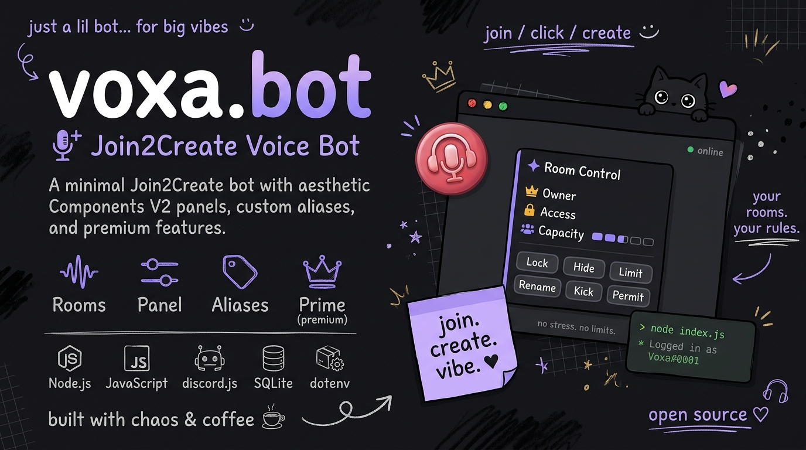

 <p align="center">
  
</p>
# ✦ Voxa

### The temporary voice channel bot that actually looks good.

*Join to create. Control everything. Ship it.*

[](https://nodejs.org)
[](https://discord.js.org)
[](https://github.com/WiseLibs/better-sqlite3)
[](https://discord.com/developers/docs/components/overview)
[](#-license)

*Every reply is a Components V2 card. No embeds. No plain text. Just vibes.*

</div>

---

## ✦ What is Voxa?

Voxa is a **Join2Create** bot: users join a hub voice channel, and instantly get their own temporary voice room with a live control panel posted in its text chat. When the last person leaves, the room disappears.

But Voxa is also *aesthetic*. Every single response — commands, errors, panels, pickers, upsells — is built with **Discord's Components V2** (containers, sections, separators, thumbnails, media galleries). Nothing is ever a plain embed or text reply.

It ships with a full **Prime** premium tier, per-user **aliases**, multi-hub support, granular **plans enforced server-side**, **voice-time leaderboards**, **Discord Activities**, **saved profiles**, and **join protection**.

---

## ✨ Features

### 🎙️ Voice rooms
- **One-click room creation** — join the hub, get a room, get a panel
- **Live control panel** — lock/hide/cam/soundboard/chat-lock/limit/rename/status in one card
- **Permit / Deny / Kick / Transfer / Claim** — full membership control
- **Managers** — per-room co-hosts and per-user global managers
- **Join protection (Prime)** — uninvited users are disconnected automatically
- **Empty grace period** — rooms wait `N` seconds for someone to rejoin before deleting
- **Auto-transfer** — if the owner leaves while others are inside, ownership passes to the longest-present human

### 🔐 Access control
- Global **whitelist** and **blacklist** that apply to every future room
- **Role-level** permit / reject
- **Request system** — post an Approve/Deny card in the target room
- **Banned-word filter** — Discord invite links always blocked by default

### ✨ Prime tier
- 25 aliases (free: 3)
- 8 room managers (free: 2)
- 10 global managers (free: 2)
- 50 whitelist / 50 blacklist slots
- Bitrate control, join protection, custom theme color
- Saved profile — name, capacity, bitrate, lock, hide, cam auto-restored on next room
- No rename cooldown, capacity up to 99

### 📊 Info & stats
- **Voice-time tracking** — batched flushes every 60s, survives restarts
- **Leaderboards** — paginated, per-server and cross-server
- **Personal stats** — time, rooms created, rank, tier, saved profile
- **Focus tasks** — per-user to-do list with plan limits

### 🛠️ Setup wizard
- **Health check** — verifies every bot permission before setup begins
- **Quick Setup** — one-click category + hub
- **Custom Setup** — category, template presets, defaults, grace, toggles, log channel, live preview
- **Multi-hub** — run `.v setup add` to spawn more hubs (e.g. "🎮 Gaming" capped at 5, "📚 Study" with cam enforced)
- **Dashboard** — edit, remove, and repair hubs from one card
- **Auto-repair** — missing channels are detected and rebuilt

---

## 🧩 Command overview

Voxa's prefix is **`.v`** — commands only match when followed by whitespace or end-of-message, so `.vxyz` is safely ignored.

### 🎙️ Voice
| Command | Aliases | Description |
|---|---|---|
| `.v name <text>` | rename, newname, nam | Rename your room |
| `.v limit <0-99>` | setlimit, userlimit, limite | Set capacity (0 = ∞) |
| `.v status <text>` | statuschannel, voicestatus | Set voice channel status |
| `.v cam [on\|off]` | stream | Toggle video |
| `.v soundboard [on\|off\|managers]` | sb | Toggle soundboard |
| `.v panel` | — | Re-post the panel |
| `.v reset` | resetvoice, vreset | Restore hub defaults |
| `.v lock / unlock` | lck / open | Deny/reset Connect |
| `.v hide / unhide` | ghost / show | Deny/reset View |
| `.v protect [on\|off]` | — | ✨ Enable join protection |
| `.v tlock / tunlock` | chatlock / unlockchat | Lock room chat |
| `.v tmute / tunmute <@user>` | textmute / textunmute | Text-mute a member |
| `.v fm` | muteall | Mute everyone but managers |
| `.v forceunmute` | fum | Undo `.v fm` |
| `.v permall` | allowall | Permit everyone inside |
| `.v pick` | rvc, vpick | Pick a random member |
| `.v activity [game]` | act | Start a Discord Activity |
| `.v fix [all]` | vfix | Repair room state |
| `.v bitrate <8-256>` | — | ✨ Set bitrate |
| `.v save` | saveprofile | ✨ Save your profile |
| `.v clear [amount]` | purge | Bulk delete messages |

### 🔐 Access
| Command | Aliases | Description |
|---|---|---|
| `.v permit <@user>` | allow, grant | Permit a member |
| `.v deny <@user>` | reject, ban | Deny + disconnect |
| `.v undeny <@user>` | unban | Reverse a deny |
| `.v permitrole / rejectrole <@role>` | pr / rr | Role-level access |
| `.v kick <@user\|@role>` | — | Kick user or role |
| `.v whitelist [add\|remove\|list\|clear]` | wl | Global whitelist |
| `.v blacklist [add\|remove\|list\|clear]` | bl | Global blacklist |
| `.v request <@owner\|room>` | req | Request to join |
| `.v claim` | — | Claim an abandoned room |
| `.v transfer <@user>` | promote, tr | Transfer ownership |
| `.v manager [add\|remove\|list]` | mgr, copilot | Room managers |
| `.v man [add\|remove\|list\|clear]` | gman | Global managers |
| `.v owner` | vcowner | Show room owner |

### 📊 Info
| Command | Aliases | Description |
|---|---|---|
| `.v help [command]` | h | Registry-driven help |
| `.v vcinfo` | vinfo | Room details |
| `.v mystats` | me, profile | Your stats |
| `.v vip` | premium, prime, sub | Prime status (owners: grant/revoke) |
| `.v primeinfo` | primefeatures | Prime showcase |
| `.v top [users\|servers]` | event, vtop | Voice-time leaderboard |
| `.v task [add\|done\|list\|clear]` | — | Personal focus tasks |
| `.v alias [add\|remove\|list\|clear]` | aliases | Custom shortcuts |

### 🛠️ Admin (`Manage Server`)
| Command | Aliases | Description |
|---|---|---|
| `.v setup [add\|edit\|remove\|status]` | vsetup | Setup wizard / dashboard |
| `.v template <text>` | — | Set name template |
| `.v commands [enable\|disable\|list]` | cmd | Toggle commands |
| `.v bannednames [add\|remove\|list]` | filter | Banned words |
| `.v resetdata` | resetguild | Purge guild data (typed `RESET` confirmation) |

---

## 🔧 Self-hosting

### 1. Requirements
- **Node.js 20+**
- A Discord application + bot token
- A server where you have `Manage Server`

### 2. Create the bot
1. Go to https://discord.com/developers/applications → **New Application**
2. **Bot** tab → **Reset Token** → copy it
3. **Privileged Gateway Intents** → enable:
   - ✅ **Message Content Intent**
   - ✅ **Server Members Intent**
4. **OAuth2 → URL Generator**
   - Scopes: `bot`
   - Permissions:
     - Manage Channels
     - Manage Roles
     - Move Members
     - View Channels
     - Connect · Speak
     - Send Messages · Embed Links
     - Read Message History
     - Manage Messages *(optional — `.v clear`)*
     - Create Instant Invite *(`.v activity`)*
     - Set Voice Channel Status *(`.v status` — if it doesn't appear, `.v status` fails gracefully)*
5. Open the generated URL and invite the bot.
6. **Drag the bot's role above any role it must affect** (Moderator, category members, etc.).

### 3. Install

```bash
git clone https://github.com/whoszyx/voxa-join2create
cd voxa
npm install
